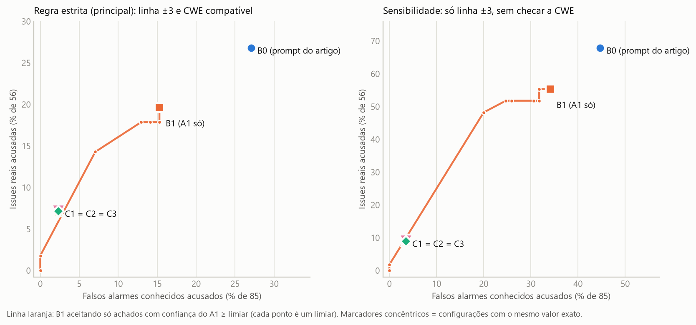
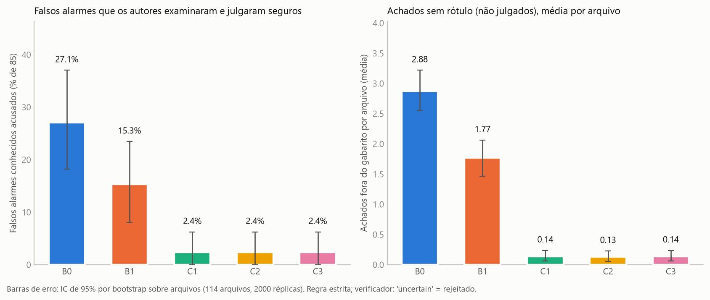
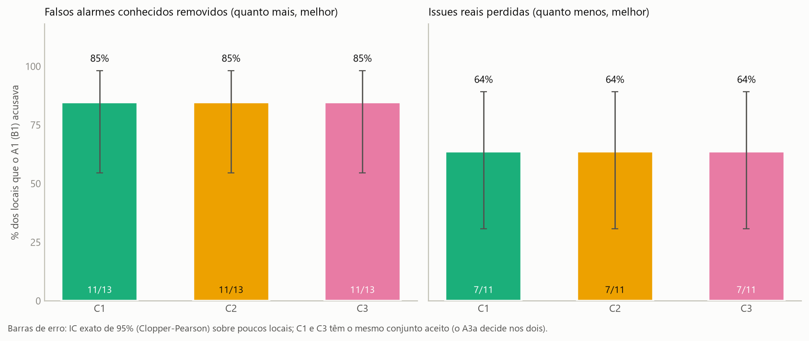

# Verificação adversarial com 3 agentes para reduzir falsos positivos na detecção de vulnerabilidades: auditoria do artigo e teste de um pipeline com modelos abertos

Projeto TAES. Artigo analisado: Belozerov, Barclay, Sami, *Secure coding with AI – from detection to repair*, Empirical Software Engineering (2026) 31:93.
Estado deste relatório (2026-11-10): **versão final**. Todas as execuções previstas para o estudo foram feitas e analisadas: a execução principal (114 arquivos, 5 configurações, `temperature=0`), o estudo de variância (B1 e C3, 3 repetições com amostragem), a E1 (respostas do artigo nos 114 arquivos), a ablação C3-mf (H5) e o A3b nos patches do B0. Essas execuções somaram 17,6 horas de GPU gratuita, mais ~3,4 horas antes delas (piloto e ajustes), sem nenhum pagamento.

## 1. Resumo

- **O que foi feito.** Foram auditados os números do artigo com os dados dos autores e testado um pipeline de 3 papéis (A1 detector, A2 corretor, A3 verificador adversarial) que roda só com modelos abertos e gratuitos (qwen2.5-coder 14B e gpt-oss 20B, no Kaggle, custo financeiro zero). A avaliação usa apenas os rótulos que os próprios autores produziram: 56 issues reais e 85 falsos alarmes de scanner que eles examinaram e julgaram seguros. Não houve anotador humano.
- **O artigo mede só recall relativo.** Os "~80% de acurácia" são detectadas ÷ 56; precisão e falso positivo nunca foram medidos, embora 66 dos 114 arquivos fossem negativos e o prompt original mande "encontrar problemas de segurança" (seção 9).
- **Resultado principal, em uma frase.** O verificador adversarial remove a maior parte dos falsos alarmes conhecidos (11 de 13 que o detector acusava, 85%), mas perde também a maior parte dos locais reais (7 de 11, 64%): a hipótese H1 ("menos falsos alarmes com perda de recall de até 5 p.p.") **não foi confirmada**; a perda de recall foi de 12,5 p.p. e o ganho de precisão não é significativo.
- **Custo da arquitetura.** C3 usa cerca de 12 vezes os tokens por issue real acusado do detector sozinho (188 mil contra 16 mil), e C2 cerca de 21 vezes (344 mil).
- **Contra as respostas do artigo (E1, exploratória).** No mesmo regime estruturado e com a mesma regra, GPT-4.1, GPT-5 e Claude Opus 4.1 acusam 43% a 48% das issues reais e 28% a 33% dos falsos alarmes conhecidos; o pipeline completo (C3) acusa 7% e 2%. A diferença de falsos alarmes (−26 a −31 p.p.) vem junto com uma perda de recall de 36 a 41 p.p., e a precisão do C3 não se distingue da dos modelos do artigo (intervalo de −30 a +57 p.p.). Ou seja, outro ponto de operação, não um pipeline melhor. A mesma base mostra o peso do modelo: com o mesmo prompt, o detector aberto (B0) acusa 16 a 21 p.p. menos issues reais que os modelos do artigo, com taxa de falsos alarmes parecida (seção 8).
- **Com outra amostragem, a conclusão se mantém (estudo de variância).** Em 3 repetições com amostragem (seeds 1 a 3, 114 arquivos, B1 e C3), o C3 reduz os falsos alarmes conhecidos em 11,8 a 12,9 p.p. em relação ao B1 (IC abaixo de zero nas três), mas perde de 7,1 a 12,5 p.p. de recall: o critério da H1 (perda de até 5 p.p.) é cumprido em **0 de 3** repetições.
- **Ablação do verificador do mesmo modelo do detector (H5, C3-mf): degenerada, não conclusiva.** Com o `qwen` (o mesmo modelo do detector) no papel de verificador, todos os 229 achados foram refutados (contra 87% de refutações do `gpt-oss`, que confirmou 23), e o C3-mf acusa 0 de 56 issues reais e 0 de 85 falsos alarmes. A H5 fica **não apoiada** pelo critério fixado antes (a diferença de falsos alarmes C3 − C3-mf é +2,4 p.p., IC 0,0 a +6,2), mas isso mostra um verificador que rejeita tudo, não um efeito de família: a comparação troca família e capacidade do modelo ao mesmo tempo.
- **Correção, com o mesmo juiz (A3b).** Aplicando o A3b aos patches do B0, o B0 corrige 3 de 15 issues reais acusadas pela regra estrita (20%; 5,4% das 56) e 10 de 38 pela regra só-linha, contra 0 de 4 no C2 e no C3. Isso reflete que o B0 acusa mais issues (15 contra 4), não que sua correção seja melhor: com 4 issues acusadas a taxa do C3 não é informativa. O A3b tem κ = 0,28 contra os rótulos dos autores e o patch do B0 é um por arquivo; leitura secundária.
- **Os números absolutos são pequenos e frágeis**: o pipeline completo acusa 4 issues reais em 56 e 2 falsos alarmes em 85 (regra estrita). Os intervalos são largos; a precisão do C3 varia de 20% a 60% entre repetições, porque se apoia em 5 a 7 locais rotulados.

## 2. Método

**Dados.** 114 arquivos (48 com ao menos uma issue real, 66 negativos) do repositório de dados dos autores, snapshots v8 (63) e v10 (51); gabarito: `gt_issues` (56 issues) e `gt_scanner_fp` (85 falsos alarmes conhecidos), com os rótulos de 2025. O arquivo `v8:File_02` fica fora da análise, como no artigo. Dados dos autores tratados como não confiáveis (compilação só com `-fsyntax-only`, Python isolado).

**Configurações** (o mesmo detector em todas; o mesmo verificador em todas, exceto no C3-mf):

| Config | Fluxo |
|---|---|
| B0 | prompt original do artigo (texto livre) + extração estruturada pelo mesmo modelo do detector |
| B1 | A1 apenas, prompt neutro que permite "nenhuma vulnerabilidade" |
| C1 | A1 → A3a (verifica o achado tentando refutá-lo, sem ver a correção) |
| C2 | A1 → A2 (corrige todos os achados) → A3 conjunto (achado e correção juntos) |
| C3 | A1 → A3a → A2 (só os confirmados) → A3b (verifica a correção, com compilação e scanners) |
| C3-mf (ablação H5) | igual ao C3, mas o A3a e o A3b usam o mesmo modelo do detector (`qwen`) |

**Modelos.** Detector e corretor: `qwen2.5-coder:14b` (Q4_K_M). Verificador: `gpt-oss:20b` (MXFP4, raciocínio médio); no C3-mf, o próprio `qwen2.5-coder:14b`. Duas GPUs T4 do Kaggle, Ollama; digest dos pesos conferido em cada execução. Execução principal: `temperature=0`, `seed=0`, teto de 4 achados por arquivo e remoção de achados repetidos (mesma CWE e linha em comum). O verificador e o corretor nunca veem a confiança do detector nem os rótulos. "Uncertain" do verificador = rejeitado na análise principal; aceito na sensibilidade S2.

**Prompts congelados antes da execução principal** (hashes em `pipeline/prompts/HASHES.md`): `a1_v2`, `a3_v1`, `a2_v1`, `a3b_v1`, `b0_paper`, `b0_extract_v1`. O `a1_v1` foi trocado por `a1_v2` depois do piloto (10 arquivos), porque a primeira versão prejudicava o recall; por isso o piloto é conjunto de ajuste e a sensibilidade S4 repete a análise nos 104 arquivos fora dele.

**Execuções adicionais.** Estudo de variância: B1 e C3 com seeds 1 a 3 e a temperatura do cartão de cada modelo (detector 0,7; verificador 1,0). E1: as respostas originais do artigo (GPT-4.1, GPT-5, Claude Opus 4.1) passam pelo mesmo extrator estruturado do B0 (`b0_extract_v1`) e pela mesma regra de correspondência. C3-mf: os achados do A1 vêm do cache da execução principal, então são os mesmos do C3 (conferido nos 114 arquivos). A3b nos patches do B0: o mesmo A3b do C3, aplicado ao último bloco de código da resposta do B0, uma vez por achado. Os critérios de análise do C3-mf e do A3b no B0 foram definidos antes dos resultados.

**Correspondência com o gabarito (F6).** Um achado casa com uma issue se estiver no mesmo arquivo, a até 3 linhas e com CWE compatível (igual, ancestral/descendente na *CWE Research View 1000*, ou da mesma família de `matching_families.yaml`). Cada issue conta no máximo uma vez; achados repetidos sobre algo já acusado ficam fora do numerador e do denominador. Um achado que casa pela mesma regra com um local de `gt_scanner_fp` é um **falso alarme conhecido**. O restante é **fora do gabarito**: não é julgado (não há anotador) e só entra em métricas descritivas. Todo achado aceito cai em exatamente uma dessas classes (conferido por contagem).

**Métricas.** Recall = issues reais acusadas ÷ 56. Taxa de falsos alarmes conhecidos = locais acusados ÷ 85. Precisão, F1, F0,5 e MCC no conjunto rotulado (141 locais). Intervalos de 95% por bootstrap sobre arquivos (2.000 réplicas); comparações pareadas por McNemar exato, Q de Cochran e Holm; diferenças pareadas por bootstrap sobre os mesmos arquivos. Só H1 a H3 são confirmatórias; o resto é exploratório.

## 3. Resultado principal (114 arquivos, regra estrita)

IC de 95% entre colchetes; o custo por configuração está na seção 6. Código e dados: `pipeline/src/f7_analyze.py`, `pipeline/results/metrics.csv`, `pipeline/results/f7_resultados.md`.

| Config | Recall (issues reais) | Falsos alarmes conhecidos | Precisão (conjunto rotulado) | F1 | MCC |
|---|---|---|---|---|---|
| B0 | 26,8% [15,1; 39,7] (15/56) | 27,1% [18,2; 37,0] (23/85) | 39,5% [25,0; 54,1] | 31,9% [19,4; 43,2] | −0,00 [−0,15; 0,14] |
| B1 | 19,6% [10,2; 31,3] (11/56) | 15,3% [8,0; 23,5] (13/85) | 45,8% [26,3; 65,5] | 27,5% [14,8; 40,0] | 0,06 [−0,10; 0,22] |
| C1 = C3 | 7,1% [1,6; 15,2] (4/56) | 2,4% [0,0; 6,2] (2/85) | 66,7% [25,0; 100] | 12,9% [3,0; 25,4] | 0,12 [−0,06; 0,26] |
| C2 | 7,1% [1,7; 14,6] (4/56) | 2,4% [0,0; 6,2] (2/85) | 66,7% [25,0; 100] | 12,9% [3,2; 24,6] | 0,12 [−0,06; 0,26] |
| C3-mf (ablação H5) | 0,0% (0/56) | 0,0% (0/85) | indefinida (nenhum achado aceito) | 0,0% | indefinido |

C1 e C3 têm o mesmo conjunto aceito por construção (o A3a decide nos dois); eles diferem só na etapa de correção. O C3-mf aparece só como referência: o verificador dele refutou todos os 229 achados (seção 4, H5).

Descritivas, sem julgamento dos achados fora do gabarito (média por arquivo, 114 arquivos):

| Config | Achados aceitos/arquivo | Fora do gabarito/arquivo (positivos; negativos) | Arquivos positivos sinalizados | Arquivos negativos sinalizados | Precisão geral, limite inferior; superior |
|---|---|---|---|---|---|
| B0 | 3,28 | 3,23; 2,62 | 100% | 93,9% [87,9; 98,6] | 4,1%; 93,7% |
| B1 | 2,01 | 2,23; 1,44 | 83,3% | 54,5% [42,0; 67,1] | 4,9%; 94,2% |
| C1 = C3 | 0,20 | 0,21; 0,09 | 20,8% | 9,1% [3,0; 17,1] | 18,2%; 90,9% |
| C2 | 0,18 | 0,19; 0,09 | 18,8% | 7,6% [1,6; 14,7] | 19,0%; 90,5% |

A fração de arquivos negativos sinalizados é um limite superior da taxa de falso positivo por arquivo, porque um achado num arquivo negativo pode ser uma vulnerabilidade real que os scanners não viram. O intervalo da precisão geral é largo de propósito: sem anotador, os achados fora do gabarito (328 de 374 no B0, 202 de 229 no B1, 16 em C1/C3) não são julgados.

**Figura 1.** Recall × taxa de falsos alarmes conhecidos: curva do B1 variando o corte de confiança do A1 e pontos das demais configurações (regra estrita à esquerda, só linha à direita).

**Figura 2.** Taxa de falsos alarmes conhecidos e média de achados fora do gabarito por arquivo, por configuração.

**Figura 3.** Efeito do verificador sobre os locais que o A1 acusava: falsos alarmes removidos e issues reais perdidas.

## 4. Hipóteses

Diferenças A − B em pontos percentuais (bootstrap pareado por arquivo, IC de 95%).

| Hipótese | Comparação | Recall | Falsos alarmes conhecidos | Precisão | Conclusão |
|---|---|---|---|---|---|
| **H1** | C3 − B1 | −12,5 [−22,0; −4,7] | −12,9 [−20,5; −6,1] | +20,8 [−18,4; +58,6] | **Não confirmada.** Os falsos alarmes caem, mas o recall cai mais que os 5 p.p. admitidos e a precisão não melhora de forma significativa. |
| **H1, repetida** (variância) | C3 − B1 em cada uma das 3 repetições com amostragem | var1: −7,1 [−14,3; −1,6]; var2: −12,5 [−22,2; −4,8]; var3: −10,7 [−19,4; −3,4] | var1: −11,8 [−18,8; −5,3]; var2: −12,9 [−20,2; −6,1]; var3: −11,8 [−19,0; −5,1] | var1: +23,2 [−21,1; +69,2]; var2: −14,8 [−47,4; +26,7]; var3: +13,7 [−20,3; +48,2] | **Critério da H1 cumprido em 0 de 3 repetições.** A queda de falsos alarmes é consistente (IC < 0 nas três) e a perda de recall também, sempre acima de 5 p.p. A precisão troca de sinal e o IC inclui 0 nas três: nem ganho nem perda detectável. |
| **H2** | B1 − B0 | −7,1 [−20,0; +4,9] | −11,8 [−20,2; −3,7] | +6,4 [−10,3; +22,8] | **Apoiada em falsos alarmes, com ressalva.** O prompt neutro acusa menos falsos alarmes conhecidos sem perda significativa de recall. McNemar nos falsos alarmes: p = 0,013 (Holm: 0,052). Ressalva: 28% dos achados extraídos do B0 não têm linha e não casam pela regra estrita (S6 abaixo). |
| **H3** | C3 − C2 | 0,0 [−5,7; +5,1] | 0,0 [0,0; 0,0] | 0,0 [−25,0; +21,4] | **Não confirmada.** Verificar sem ver a correção não rejeitou mais falsos alarmes do que verificar com ela: os dois acusam os mesmos 2. A vantagem de C3 é de custo: 2 patches desnecessários contra 14, e 72 s contra 197 s de chamada por arquivo. |
| **H4** | C1/C3 contra a curva do B1 | com a mesma taxa de falsos alarmes (2,4%), o melhor corte de confiança do B1 acusa 1/56 (1,8%); C1/C3 acusam 4/56 | | | **Evidência fraca a favor** (+5,4 p.p.), mas baseada em 4 contra 1 locais; exploratória na prática. |
| **H5** (exploratória) | C3 − C3-mf (verificador `gpt-oss`, de outra família, contra `qwen`, o mesmo modelo do detector) | +7,1 [+1,6; +15,2] | +2,4 [0,0; +6,2] | indefinida (o C3-mf não aceita nenhum achado) | **Não apoiada, e o teste é degenerado.** O qwen como verificador refutou **229 dos 229** achados do detector (o `gpt-oss` confirmou 23, 10%), então o C3-mf acusa 0 de 56 issues reais e 0 de 85 falsos alarmes: ele "remove mais falsos alarmes" só porque remove tudo. McNemar exato por local: reais 4 só no C3 e 0 só no C3-mf (p = 0,125); falsos alarmes 2 contra 0 (p = 0,5). O teste confunde a família com a capacidade e a calibração do modelo (qwen 14B sem raciocínio contra `gpt-oss` 20B com raciocínio) e com o prompt adversarial: não permite concluir nada sobre erros correlacionados. |
| **E1** (exploratória) | C3 − modelos do artigo (GPT-4.1 / GPT-5 / Opus 4.1) | −35,7 / −41,1 / −37,5 [IC exclui 0 nos três] | −29,4 / −25,9 / −30,6 [IC exclui 0] | +19,6 / +13,7 / +19,5 (ICs de cerca de −30 a +57) | **O C3 acusa muito menos falsos alarmes, mas só porque acusa muito menos issues reais; a precisão não se distingue.** Ver tabela abaixo. |

Testes pareados no nível de local (todos, com Holm; só as linhas H1 a H3 são confirmatórias, o resto é exploratório):

- Detecção de issues reais (56): Q de Cochran = 28,4 (gl 4), p = 1,0·10⁻⁵. B1 × C3: 7 locais só no B1, 0 só no C3, p = 0,016 (Holm 0,11). B0 × B1: 8 contra 4, p = 0,39. C2 × C3: 1 contra 1, p = 1.
- Acusação de falsos alarmes conhecidos (85): Q de Cochran = 65,0 (gl 4), p = 2,6·10⁻¹³. B1 × C3: 11 contra 0, p = 0,001 (Holm 0,007). B0 × B1: 12 contra 2, p = 0,013 (Holm 0,052). C2 × C3: 0 contra 0, p = 1.

**O verificador remove muito, mas discrimina pouco.** Dos locais que o B1 acusava, o verificador removeu 11/13 falsos alarmes (85%) e 7/11 issues reais (64%). Manteve 4/11 reais e 2/13 falsos alarmes (Fisher exato, p = 0,36): não há evidência de que ele separe real de falso melhor do que rejeitando quase tudo. Na calibração (A3a sobre os 141 achados reconstruídos dos scanners, 139 julgados), ele confirmou 22/56 reais (39%) e 4/85 falsos alarmes (5%) (Fisher p = 3·10⁻⁷); essa sensibilidade de 39% já indicava que o limite de 5 p.p. de perda de recall seria difícil de cumprir.

**E1 em detalhe (114 arquivos, extração estruturada pelo mesmo extrator do B0, regra estrita; IC de 95% por bootstrap sobre arquivos).** Os modelos do artigo são outros, comerciais e maiores, e as respostas deles foram escritas para o prompt original, sem linha obrigatória; por isso a comparação é exploratória.

| Config | Issues reais acusadas | Falsos alarmes acusados | Recall | Falsos alarmes | Precisão |
|---|---|---|---|---|---|
| B0 (abertos) | 15/56 | 23/85 | 26,8 [15,1; 39,7] | 27,1 [18,2; 37,0] | 39,5 [25,0; 54,1] |
| B1 (abertos) | 11/56 | 13/85 | 19,6 [10,2; 31,3] | 15,3 [8,0; 23,5] | 45,8 [26,3; 65,5] |
| C3 (abertos) | 4/56 | 2/85 | 7,1 [1,6; 15,2] | 2,4 [0,0; 6,2] | 66,7 [25,0; 100,0] |
| GPT-4.1 (artigo) | 24/56 | 27/85 | 42,9 [30,6; 55,7] | 31,8 [21,7; 41,7] | 47,1 [32,7; 61,5] |
| GPT-5 (artigo) | 27/56 | 24/85 | 48,2 [34,8; 62,2] | 28,2 [19,0; 38,5] | 52,9 [38,6; 66,7] |
| Opus 4.1 (artigo) | 25/56 | 28/85 | 44,6 [31,5; 56,8] | 32,9 [23,3; 43,0] | 47,2 [33,3; 60,3] |

Com a regra só-linha (sensibilidade), os modelos do artigo chegam a 84%–91% de recall, perto dos ~80% divulgados, mas também a 57%–67% dos falsos alarmes conhecidos; o regime estruturado reproduz a ordem de grandeza do artigo. Uma extração do GPT-4.1 (`v8:File_04`, feita ainda no piloto) falhou (o extrator atingiu o limite de tokens de saída nas 3 tentativas) e ficou sem achados. O recall e os falsos alarmes dos modelos comerciais são bem maiores que os do C3, enquanto a taxa de falsos alarmes deles (28%–33%) é parecida com a do B0 aberto (27%): neste teste, o problema de falsos alarmes não é pior nos modelos comerciais; o pipeline apenas opera num ponto muito mais conservador.

**Variância em detalhe (B1 e C3, 114 arquivos, regra estrita; detector com temperatura 0,7 e verificador com 1,0, seeds 1 a 3).**

| Repetição | B1 recall | B1 falsos alarmes | B1 precisão | C3 recall | C3 falsos alarmes | C3 precisão |
|---|---|---|---|---|---|---|
| var1 | 12,5% (7/56) | 14,1% (12/85) | 36,8% | 5,4% (3/56) | 2,4% (2/85) | 60,0% |
| var2 | 14,3% (8/56) | 17,6% (15/85) | 34,8% | 1,8% (1/56) | 4,7% (4/85) | 20,0% |
| var3 | 17,9% (10/56) | 15,3% (13/85) | 43,5% | 7,1% (4/56) | 3,5% (3/85) | 57,1% |
| Média ± desvio-padrão (n = 3) | 14,9 ± 2,7 | 15,7 ± 1,8 | 38,4 ± 4,5 | 4,8 ± 2,7 | 3,5 ± 1,2 | 45,7 ± 22,3 |
| Execução principal (T = 0) | 19,6% | 15,3% | 45,8% | 7,1% | 2,4% | 66,7% |

Com 3 repetições o desvio-padrão é uma estimativa grosseira. A execução principal (temperatura 0) fica dentro da variação das repetições, com o B1 um pouco acima da média amostrada (recall 19,6% contra 14,9%). Arquivos negativos sinalizados: 50% a 58% no B1 e 12% a 14% no C3.

## 5. Sensibilidade e robustez

Mesmas métricas, mesmo bootstrap; tabelas completas em `pipeline/results/f7_resultados.md`.

| Variante | B0 | B1 | C1 = C3 | C2 |
|---|---|---|---|---|
| Principal (estrita) | 26,8% / 27,1% | 19,6% / 15,3% | 7,1% / 2,4% | 7,1% / 2,4% |
| S1: só linha ±3, sem checar CWE | 67,9% / 44,7% | 55,4% / 34,1% | 8,9% / 3,5% | 8,9% / 3,5% |
| S2: "uncertain" aceito | 26,8% / 27,1% | 19,6% / 15,3% | 8,9% / 2,4% | 7,1% / 2,4% |
| S3: só segurança (54 issues) | 27,8% / 27,1% | 20,4% / 15,3% | 7,4% / 2,4% | 7,4% / 2,4% |
| S4: 104 arquivos fora do piloto | 25,5% / 25,3% | 19,1% / 13,9% | 8,5% / 2,5% | 8,5% / 2,5% |
| S5: sem os 2 arquivos do B0 com extração falha | 26,8% / 27,7% | 19,6% / 15,7% | 7,1% / 2,4% | 7,1% / 2,4% |
| S6 (exploratória): arquivo + CWE, sem exigir linha | 42,9% / 40,0% | 28,6% / 23,5% | 8,9% / 4,7% | 8,9% / 3,5% |

Cada célula é recall / taxa de falsos alarmes conhecidos. As conclusões qualitativas não mudam: o verificador corta a taxa de falsos alarmes e o recall juntos. Duas leituras importantes:

1. **A regra estrita mede muito a CWE que o modelo escolhe.** O B1 sobe de 19,6% para 55,4% de recall quando se ignora a CWE (S1): o A1 (qwen 14B) usa CWE-78 em quase tudo. Isso não muda a comparação entre configurações (todas usam o mesmo A1), mas os números absolutos dependem fortemente da regra.
2. **O verificador discrimina pouco também em S1:** dos 31 locais reais e 29 falsos alarmes que o B1 acusava só pela linha, o verificador mantém 5 e 3 (16% e 10%).

A comparação B0 × B1 deve ser lida com cuidado: 106 dos 374 achados do B0 (28%) não trazem linha e não casam pela regra estrita. O B0 sobe bastante em S1 e S6, e continua acusando mais falsos alarmes que o B1 nas duas.

## 6. Custo computacional

Execução principal inteira: **9,7 horas de GPU** (duas metades de 5,6 e 4,1 horas, em paralelo, 2×T4 cada), sem nenhuma entrada de pagamento; a estimativa original era ~14 horas. Cada configuração contada sozinha (o A1 e o A3a compartilhados contam em todas as que os usam):

| Config | Chamadas/arquivo | Tokens de entrada/arquivo | Tokens de saída/arquivo | Segundos de chamada/arquivo | Tokens por issue real acusada |
|---|---|---|---|---|---|
| B0 | 2 | 3.294 | 2.447 | 158 | 43.632 |
| B1 | 1 | 1.193 | 353 | 23 | 16.020 |
| C1 | 3 | 4.090 | 1.373 | 54 | 155.689 |
| C2 | 5 | 8.133 | 3.944 | 197 | 344.205 |
| C3 | 3,4 | 4.883 | 1.728 | 72 | 188.415 |

A extração das respostas do artigo nos 66 negativos (`f5neg`, 198 extrações, todas bem-sucedidas) custou 1,03 hora de GPU; o estudo de variância (`f5var`, B1 e C3 × 3 repetições × 114 arquivos, 0 erros) custou 3,94 horas. O C3-mf (`f5mfa` e `f5mfb`, 114 arquivos) custou 0,76 hora (0,36 + 0,40), porque o verificador `qwen` refutou todos os achados e o corretor e o juiz da correção nem chegaram a rodar. O A3b nos patches do B0 (`f5b0fix`, 373 julgamentos, 0 erros) custou 2,17 horas (80 s por chamada, contra 28 s no A3b do C3, porque o patch do B0 é o arquivo inteiro). No total, os cinco blocos somam cerca de 17,6 horas de GPU gratuita (9,7 + 1,03 + 3,94 + 0,76 + 2,17), sem nenhum pagamento. O custo em dólares numa API paga não foi calculado: era um item opcional do plano e foi dispensado; os tokens acima são a base para isso.

## 7. Correção (secundária)

A avaliação automática da correção tem baixa concordância com os rótulos "Was issue fixed" dos autores (κ = 0,28 para o A3b = `valid` sobre os 56 patches do GPT-4.1 do artigo; 0,42 se `partial` conta; só ferramentas, 0,13). Por isso as taxas abaixo são secundárias e ficam como limitação.

- C2 e C3: das 4 issues reais acusadas, nenhuma passou nos critérios combinados (veredito `valid`, regra do scanner sumiu, compila, sem novo warning): taxa de correção condicional e global 0/4 e 0/56, com 1 `valid` do A3b em 4. Com tão poucas issues acusadas, a taxa não é informativa.
- B0 com o mesmo A3b (`f5b0fix`): o patch do B0 é o último bloco de código da resposta, **um por arquivo**, usado para todos os achados do arquivo; o A3b julgou cada um dos 373 achados do B0 em arquivos com patch (`valid` 141, 38%; `partial` 47, 13%; `invalid` 185, 50%). Nas issues reais acusadas pelo B0: regra estrita, 15 acusadas, 5 com `valid`, **3 corrigidas pelos critérios combinados (20% condicional; 5,4% global)**; só linha ±3, 38 acusadas, 10 corrigidas (26,3%; 17,9%). Pelos critérios de ferramentas sozinhos (regra estrita): a regra do scanner sumiu em 3, continuou em 9 e não é verificável em 3; o patch compila em 4 de 5 verificáveis (10 não verificáveis); aparece aviso novo em 1.
- **Leitura da comparação de correção.** O B0 corrige mais em números absolutos (3 de 56 contra 0 de 56 no C2 e no C3), mas só porque acusa mais issues reais (15 contra 4); a taxa condicional do C3 (0 de 4) não é informativa, e a do B0 (3 de 15) mostra que, mesmo acusando mais, ele corrige pouco. Não há evidência de que a correção do pipeline seja melhor que a do B0, e o A3b (κ = 0,28 contra "Was issue fixed") limita a confiança. O C2 e o C3 geram um patch por achado e o B0 um por arquivo: a comparação não é um-para-um.
- Correção desnecessária (patches para falsos alarmes conhecidos): 14 em C2, 2 em C3.

## 8. Ameaças à validade

- **Gabarito dos autores.** (a) Cobre o que scanners acham e inclui itens de qualidade (CWE-561, CWE-1164; recorte "só segurança" em S3). (b) Os rótulos têm um avaliador principal e mudaram entre 2024 e 2025. (c) Parece incluir **riscos de padrão** (um `strlen`, um `strncpy`, um `printf` que o scanner marca) em que o verificador procura **explorabilidade**; das 11 issues reais que o B1 acusou, o A3a confirmou 4, refutou 6 e deu 1 "uncertain". Li o começo das 6 refutações (texto truncado, não é auditoria): trazem argumentos que parecem plausíveis (`strlen` não escreve fora do buffer, `strncpy` com terminação explícita, `printf` com formato constante). Isso **poderia** explicar parte da "perda de verdadeiros positivos"; sem anotador não dá para afirmar que as rejeições estão certas.
- **Falsos alarmes só de tipo scanner.** Os 85 negativos cobrem os falsos alarmes que scanners geram, não as alucinações livres dos modelos; estas só aparecem como achados fora do gabarito, não julgados.
- **Amostra pequena.** 56 issues reais e 85 falsos alarmes; as configurações com verificador acusam 4 e 2 locais. Os intervalos são largos (ex.: precisão de C3: 25% a 100%).
- **Execução única.** `temperature=0` não é totalmente reprodutível com respostas longas (no piloto, B0: 1 de 10 respostas idênticas; A3a: 2 de 5), embora os conjuntos de achados aceitos tenham sido quase sempre iguais (B1, C1, C3: 10 de 10; C2: 9 de 10; B0: 4 de 10). O estudo de variância (B1 e C3, 3 repetições com amostragem, seção 4) foi executado: a conclusão da H1 se mantém nas três repetições, mas os intervalos de confiança das tabelas principais (execução única, bootstrap sobre arquivos) continuam sem incluir a incerteza de amostragem do modelo; com 3 repetições o desvio-padrão entre elas é só uma estimativa grosseira. B0, C1 e C2 não foram repetidos.
- **Correspondência.** A regra (linha ±3 e CWE compatível) não atingiu κ ≥ 0,7 contra os rótulos `detected` dos autores no teste da F4 (0,08 a 0,27), porque esses rótulos são lenientes (cerca de 80% "sim"). Declarado como limitação; a sensibilidade S1 e a S6 mostram o quanto o resultado depende da regra.
- **Modelos menores que os do artigo.** Os números absolutos não são comparáveis aos do artigo (GPT-4.1, GPT-5, Claude Opus 4.1); só as comparações internas, com o mesmo modelo em todas as configurações, são válidas. Uma comparação exploratória, feita depois dos resultados, mede o peso do modelo do detector. Com o mesmo prompt original, o mesmo extrator, a mesma regra e os mesmos 114 arquivos, o B0 (qwen 14B) acusa 26,8% das issues reais, contra 42,9% a 48,2% dos modelos do artigo: diferença pareada de −16,1 [−30,9; 0,0], −21,4 [−35,4; −6,2] e −17,9 [−29,4; −4,3] p.p. contra GPT-4.1, GPT-5 e Opus 4.1. A taxa de falsos alarmes fica parecida (diferença de −1,2 a −5,9 p.p., IC incluindo 0). Olhando só a linha, os modelos maiores apontam mais locais de todo tipo (reais e falsos alarmes) com a mesma precisão (+0,5 a +2,8 p.p.); com a CWE exigida, também acertam mais a classificação, enquanto o detector aberto tem fixação em CWE-78 (o B1 vai de 19,6% para 55,4% de recall quando a CWE é ignorada). Ou seja, boa parte do recall absoluto baixo vem do detector menor. Isso não explica a H1, que compara configurações com o mesmo detector e o mesmo verificador. Se um verificador mais forte perderia menos issues reais não foi testado: o C3-mf, com um verificador mais fraco, refutou tudo, o que é coerente com a capacidade importar, mas confunde família e capacidade.
- **E1 (respostas do artigo).** Os modelos do artigo são outros e maiores; a extração estruturada das respostas deles é feita por um modelo de 14B (a mesma do B0, para tratar todos igual), que pode errar linha ou CWE; e a falha de extração de `v8:File_04` no GPT-4.1 favorece levemente esse modelo na precisão. A E1 é só descritiva e não entra nas hipóteses confirmatórias.
- **Ajuste no piloto.** O `a1_v2` foi escolhido depois de olhar 10 arquivos; S4 repete a análise nos outros 104.
- **Contaminação.** O DevGPT, o artigo e o repositório de dados são públicos; os modelos podem ter visto os rótulos. Não foi testada variante com identificadores renomeados.
- **Erros correlacionados entre detector e verificador (H5).** Neste estudo o verificador (`gpt-oss:20b`) já é de outra família que o detector (`qwen2.5-coder:14b`), como previsto no desenho do experimento. A ablação C3-mf (verificador e juiz da correção também no `qwen`) foi executada, mas não responde à pergunta: o `qwen` refutou todos os 229 achados (100%, com confiança de 0,8 a 1,0 e argumentos plausíveis), contra 87% de refutações do `gpt-oss`, de modo que o C3-mf acusa 0 issues reais e 0 falsos alarmes. A ablação troca a família e o modelo ao mesmo tempo (14B sem raciocínio contra 20B com raciocínio), e o prompt adversarial pede para refutar. Separar a família da capacidade exigiria outra variante (por exemplo, um verificador de outra família sem raciocínio, ou o `qwen` sobre os 141 locais do scanner da calibração do A3a), que não foi feita.
- **Compilação.** Só 37 dos 114 fragmentos compilam; os critérios de correção têm cobertura parcial (ver `f4_piloto.md`).
- **Falha de extração no B0.** 2 das 114 extrações estruturadas falharam (arquivos negativos `v10:File_14` e `v10:File_20`; respostas muito longas): sem achados, o que favorece o B0 na precisão. S5 repete a análise sem esses dois arquivos.
- **Semgrep.** As regras (`p/default`) não têm versão fixada; as execuções ocorreram em 9 e 10 de novembro de 2026.

## 9. Auditoria do artigo (resumo; detalhes em `pipeline/results/auditoria_artigo.md`)

Recalculada a partir das Tabelas 11–14, 17 e 18 do PDF e dos dados dos autores, sem LLM:

| Item | Veredito |
|---|---|
| Tabela 11 (GPT-4o, 2024): texto diz 17 corrigidas e 15 não; a tabela tem 16 e 16 | confirmado |
| Tabelas 17 e 18 (código do usuário × código gerado): células divergem da recontagem (3 de 6) | confirmado |
| Finding 15 ("todos os modelos vão melhor em código do usuário") | refutado para GPT-4.1 e Claude Opus 4.1 |
| "GPT-5 corrigiu todas as 44 issues que detectou": detectou e corrigiu 44, mas não as mesmas issues | refutado |
| O gabarito mudou entre 2024 e 2025 no mesmo snapshot (4 issues saíram; 2 tiveram metadados alterados) | confirmado |
| Significância da "melhora" de 2024 para 2025 (McNemar exato nos 28 itens comuns: p = 0,065 a 0,267) | não significativa |
| "Re-scanning of the modified code" (resumo) × reescaneamento como trabalho futuro (p. 35) | inconsistência confirmada |
| Número de scanners (texto diz 3, artigo usa 4) e critério de seleção de arquivos (49 de 56 issues vêm de um só scanner) | inconsistência confirmada |
| "Accuracy" nos Findings 4 e 15: é recall relativo ao gabarito, sem precisão nem falsos positivos | rótulo inadequado |
| CWEs trocadas na Tabela 14 (`v10:3/7` e `v10:3/11`) | confirmado |

Indicadores de falso positivo do próprio artigo (configuração original, reanálise da F2): os modelos citam em média 4,8 a 6,5 CWEs por arquivo (contra cerca de 1,2 issue real por arquivo positivo); em arquivos negativos, 98,5% a 100% citam ao menos uma CWE; e, na leitura estrita, 35% a 42% dos 85 falsos alarmes conhecidos são citados. Cada modelo foi rodado uma única vez (`repetitions: 1`), e o artigo não traz intervalo de confiança.

## 10. Conclusão e próximos passos

Num experimento controlado, com modelos abertos e gratuitos, o verificador adversarial **reduz bastante os falsos alarmes conhecidos e os achados fora do gabarito, mas também derruba o recall e não mostra capacidade significativa de separar issues reais de falsos alarmes**. Portanto, a premissa "mais um agente verificador resolve o falso positivo sem perder detecção" não se confirma aqui. Três fatores limitam essa conclusão: o gabarito mistura riscos de padrão com vulnerabilidades exploráveis; o detector de 14B erra a CWE com frequência (o que a regra estrita pune); e os modelos são menores que os do artigo. Com o mesmo prompt, o detector aberto acusa 16 a 21 p.p. menos issues reais que GPT-4.1, GPT-5 e Opus 4.1, com taxa de falsos alarmes parecida (seção 8), e um verificador mais forte não foi testado.

Os resultados complementares apontam na mesma direção:

- **Variância:** em 3 repetições com amostragem, o critério da H1 não foi cumprido em nenhuma (falsos alarmes −11,8 a −12,9 p.p.; recall −7,1 a −12,5 p.p.), e a precisão do C3 oscila de 20% a 60% sem diferença detectável em relação ao B1.
- **E1:** contra GPT-4.1, GPT-5 e Opus 4.1 (mesmo regime estruturado, mesma regra), o pipeline aberto acusa muito menos falsos alarmes conhecidos, mas só porque acusa muito menos issues reais; a precisão não se distingue.
- **H5:** o verificador do mesmo modelo do detector refutou todos os achados; a ablação não separa o efeito da família do efeito da capacidade do modelo e não permite concluir nada sobre erros correlacionados.
- **Correção:** com o mesmo juiz (A3b), o B0 corrige 3 de 15 issues acusadas e o C3, 0 de 4; não há evidência de que verificar antes de corrigir melhore a correção, e o juiz concorda pouco com os autores (κ = 0,28).

Em resumo: neste estudo, o verificador adversarial desloca o ponto de operação (menos alarmes e menos detecção) em vez de melhorar a discriminação. Há um contraste que vale registrar: sobre os achados reconstruídos do scanner (calibração), o `gpt-oss` separou real de falso (confirmou 39% dos reais e 5% dos falsos alarmes, p = 3·10⁻⁷); sobre os achados do detector, não (Fisher p = 0,36). A discriminação, portanto, depende do tipo de achado que o verificador recebe.

**Próximos passos possíveis (não feitos):** uma variante que separe a família da capacidade do verificador (seção 8, H5); um anotador humano para julgar os achados fora do gabarito (328 no B0 e 202 no B1 seguem sem rótulo); um detector maior, para reduzir o erro de CWE e aumentar o recall; um verificador mais forte, para saber se ele perderia menos issues reais. GPU usada: 17,6 horas nas execuções da F5, mais ~3,4 horas no piloto e nos ajustes; a cota semanal está estimada em ~21 de ~30 horas (a confirmar na interface do Kaggle).

## Reprodutibilidade

Os hashes dos prompts congelados estão em `pipeline/prompts/HASHES.md`, e as versões e os digests dos modelos, em `pipeline/config.yaml`. Resultados por arquivo: `pipeline/runs/<config>/main/*.json` (B0, B1, C1, C2, C3, C3mf) e `pipeline/runs/{B1,C3}/var1..var3/` (variância); respostas do artigo extraídas em `pipeline/results/paper_extract/`; A3b nos patches do B0 em `pipeline/results/b0_fix_validation/`; respostas brutas dos modelos em `pipeline/cache/`; relatórios dos kernels em `pipeline/results/f5/`. Os kernels do Kaggle são gerados por `kaggle/make_job.py` a partir de `kaggle/run/run.py`, e o Dataset por `kaggle/build_dataset.py`. Comandos, na raiz do projeto: `pipeline\.venv\Scripts\python.exe -I pipeline\src\f7_analyze.py` (métricas e testes estatísticos) e `pipeline\.venv\Scripts\python.exe -I pipeline\src\f8_figures.py` (figuras); 158 testes automáticos em `pipeline/tests/`.
